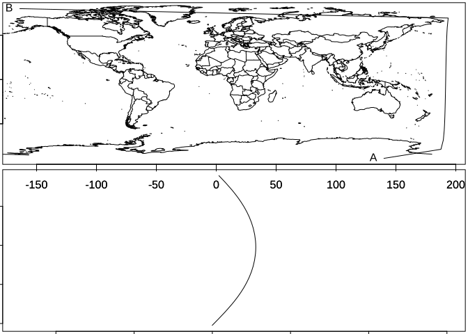
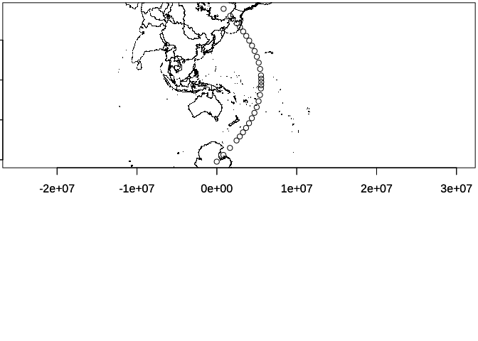
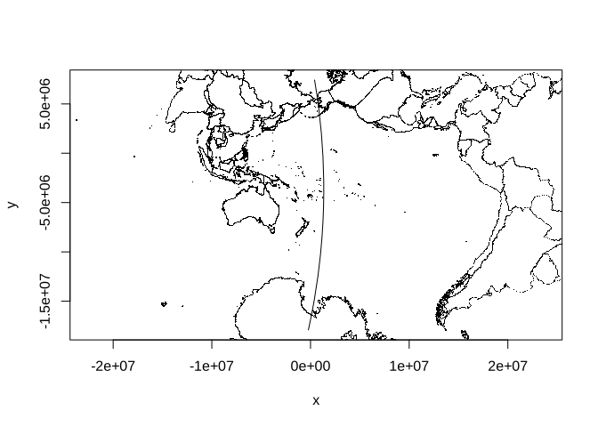
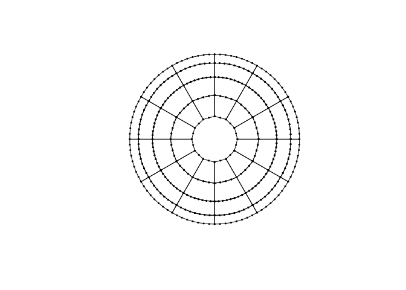

<!-- README.md is generated from README.Rmd. Please edit that file -->

# bigcurve

<!-- badges: start -->

[](https://github.com/hypertidy/bigcurve/actions/workflows/R-CMD-check.yaml)
<!-- badges: end -->

The goal of bigcurve is to adaptively densify lines: insert vertices
along great circle arcs exactly where a map projection bends them, and
nowhere else. This is the adaptive resampling scheme of d3-geo by Mike
Bostock, brought to R for paths and for segment meshes.

The error is controlled in the plane of the target projection: straight
chords drawn between output vertices stay within `tolerance` (in
projected units) of the true projected curve. By default the tolerance
is derived from the projected extent: about one part in 2048 of the
plot.

## Installation

Once bigcurve is on CRAN:

``` r
install.packages("bigcurve")
```

The development version is on r-universe:

``` r
install.packages("bigcurve", repos = c("https://hypertidy.r-universe.dev", "https://cloud.r-project.org"))
```

Building from source needs the PROJ development library (`libproj-dev`
on Debian/Ubuntu, `proj-devel` on Fedora, `proj` from Homebrew); Rtools
on Windows has PROJ built in.

## Example

We get *just enough* points to carry the curvature of a line from point
A to point B (the shortest great circle distance) into a projection.

``` r
library(bigcurve)
crs <- "+proj=tmerc +lon_0=147 +lat_0=-42"
s <- segment(c(140, -164), c(-89, 80))
d <- densify(s, crs)
dim(d)
#> [1] 30  2

op <- par(mfrow = c(2, 1), mar = rep(0.2, 4))
m <- do.call(cbind, maps::map(plot = FALSE)[1:2])
plot(d, type = "l"); lines(m); axis(1); axis(2)
text(s, lab = c("A", "B"), pos = 2)
plot(rproj_xy(d, crs), type = "l", asp = 1)
```



``` r
plot(rproj_xy(d, crs), type = "p", asp = 1)

points(rproj_xy(m, crs), pch = ".")
axis(1); axis(2)
par(op)
```



The same path in a different projection is the *same path*, densified
differently, because the curvature is a different situation there.

``` r
crs2 <- "+proj=stere +lon_0=180 +lat_0=20"
d2 <- densify(s, crs2)
plot(rproj_xy(d2, crs2), type = "l", asp = 1)
points(rproj_xy(m, crs2), pch = ".")
```



## Graticules and shared boundaries

`densify()` also works on segment meshes (rgl mesh3d style, `vb`
vertices and `is` segment indices), and on vertex pool topology from
[wkpool](https://github.com/hypertidy/wkpool), so any geometry that wk
can read refines in one call. An edge shared by two neighbouring
polygons gets the same new vertices from both sides.

``` r
## a coarse 30 degree world grid, as polygons
lon <- seq(-180, 150, by = 30)
lat <- seq(-60, 30, by = 30)
cells <- expand.grid(x = lon, y = lat)
wkt <- sprintf("POLYGON ((%s %s, %s %s, %s %s, %s %s, %s %s))",
               cells$x, cells$y, cells$x + 30, cells$y, cells$x + 30, cells$y + 30,
               cells$x, cells$y + 30, cells$x, cells$y)
pool <- wkpool::establish_topology(wk::wkt(wkt, crs = "OGC:CRS84"))

prj <- "+proj=laea +lon_0=0 +lat_0=-90"
out <- densify(pool, prj)
c(input = nrow(wkpool::pool_vertices(pool)),
  output = nrow(wkpool::pool_vertices(out)))
#>  input output 
#>    240    744

## project the refined segments for display
v <- wkpool::pool_vertices(out)
s <- wkpool::pool_segments(out)
xy <- rproj_xy(cbind(v$x, v$y), prj)
p0 <- xy[match(s$.vx0, v$.vx), ]
p1 <- xy[match(s$.vx1, v$.vx), ]
plot(rbind(p0, p1), type = "n", asp = 1, axes = FALSE, xlab = "", ylab = "")
segments(p0[, 1], p0[, 2], p1[, 1], p1[, 2])
points(xy, pch = 19, cex = 0.3)
```



## bigcurve and s2

s2 and bigcurve agree that an edge between two longitude, latitude
points is a great circle arc. s2 works out what a shape is on the sphere
(intersections, areas, distances); bigcurve draws that shape in any map
projection with just enough vertices. The vignette walks through the
difference: `vignette("bigcurve-and-s2", package = "bigcurve")`.

## Notes

Output coordinates are in the source coordinate system (geographic by
default); project them for plotting, as above. Points that cannot be
projected (beyond the horizon of an orthographic projection, say) never
error: their segments are simply left alone, clipping is a job for
another package.

The proper source of goodness is here:

<https://bost.ocks.org/mike/example/>

------------------------------------------------------------------------

## Code of Conduct

Please note that the bigcurve project is released with a [Contributor
Code of
Conduct](https://contributor-covenant.org/version/2/0/CODE_OF_CONDUCT.html).
By contributing to this project, you agree to abide by its terms.
