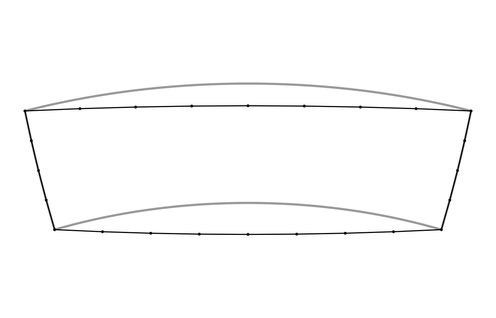
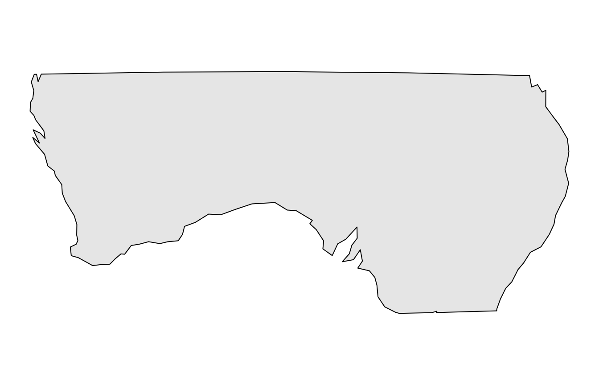

# bigcurve and s2: drawing the sphere on a flat map

If you already use s2 (directly, or through sf, where it is the default
for longitude and latitude data) you may wonder where bigcurve fits. The
short answer: **they agree on what a line between two points on the
Earth is, and they answer different questions about it.**

- s2 answers *“what is this shape on the sphere, and how does it relate
  to other shapes?”* Does it intersect, what is its area, what is the
  union, how far apart are these?
- bigcurve answers *“how many points do I need to draw this shape in a
  given map projection so that it looks right, and no more?”*

This guide walks through the shared idea, where each package does its
work, and how to use them together.

``` r

library(bigcurve)
library(s2)
```

## The shared idea: an edge is a great circle

Give a computer two points in longitude and latitude and ask for the
line between them. There are two common answers.

1.  The **planar** answer: draw a straight line in longitude, latitude
    space, as if the coordinates were x and y on graph paper. This was
    what sf and GEOS did for years, and what most file formats quietly
    assume.
2.  The **geodesic** answer: follow the shortest path over the surface
    of the Earth, a great circle arc.

s2 takes the second answer for every edge, and so does bigcurve. Take a
line along latitude 60 from longitude 0 to longitude 100. The planar
middle of that line is (50, 60). The great circle middle is a long way
north of it:

``` r

line <- s2_make_line(c(0, 100), c(60, 60))
s2_as_text(s2_interpolate_normalized(line, 0.5))
#> [1] "POINT (49.99999999999999 69.63942512488693)"

## how far is the planar middle from the true line, in metres?
s2_distance(s2_lnglat(50, 60), line)
#> [1] 1071857
```

More than a thousand kilometres. Neither answer is wrong, they are two
different shapes that happen to share their vertices. What matters is
knowing which one your data means. s2 makes the geodesic reading the
default; bigcurve assumes it.

bigcurve inserts its new vertices exactly on s2’s arc. Densify the same
line and ask s2 how far each new vertex is from the line:

``` r

d <- densify(segment(c(0, 100), c(60, 60)),
             "+proj=laea +lon_0=50 +lat_0=60", tolerance = 1000)
nrow(d)
#> [1] 13
max(s2_distance(s2_lnglat(d[, 1], d[, 2]), line))
#> [1] 1.749256e-09
```

A few nanometres, which is floating point noise. The added vertices
change nothing about the shape on the sphere; they only make it explicit
for a flat drawing.

## Where the work happens

s2 does all its work on the sphere itself. Internally every point is a
unit vector in three dimensions, and there is no map projection anywhere
in sight. That is why s2 has no trouble at the poles or at the
antimeridian: on a sphere there is no edge of the map to fall off.

bigcurve does its work in the **plane of the map you are going to
draw**. For each edge it projects the great circle midpoint with PROJ
and asks how far it lands from the straight chord between the projected
endpoints. If it is further than `tolerance` (in the map’s own units,
usually metres) the edge is split and both halves are checked again.
This is the adaptive resampling that Mike Bostock wrote for d3-geo.

That one difference explains most of what follows:

- A tolerance in bigcurve is “how far may the drawn line stray on the
  map”. The default is about one part in 2048 of the map, roughly a
  pixel on a large plot.
- The same edge gets **different** numbers of vertices in different
  projections, because the curve is a different shape on each map. An
  edge that is straight in one projection gets no new vertices at all.

``` r

s <- segment(c(0, 100), c(60, 60))
c(laea  = nrow(densify(s, "+proj=laea +lon_0=50 +lat_0=60", tolerance = 1000)),
  stere = nrow(densify(s, "+proj=stere +lat_0=90", tolerance = 1000)),
  merc  = nrow(densify(s, "+proj=merc", tolerance = 1000)))
#>  laea stere  merc 
#>    13    17    65
```

## Same shape, two readings

Here is a “box” written with four corners, from longitude 100 to 160 and
latitude -35 to -20. As planar data its sides are parallels and
meridians. As s2 (and bigcurve) read it, the north and south sides are
great circles, and they bow away from the equator:

``` r

box <- s2_make_polygon(c(100, 160, 160, 100), c(-35, -35, -20, -20))
south <- s2_make_line(c(100, 160), c(-35, -35))
s2_as_text(s2_interpolate_normalized(south, 0.5))
#> [1] "POINT (130 -38.95657940063204)"
```

Densify it for a map centred on Australia and draw both readings. Grey
is the planar reading (sides along parallels and meridians), black is
the geodesic reading with bigcurve’s added vertices (the points).

``` r

prj <- "+proj=laea +lon_0=130 +lat_0=-30"
pool <- wkpool::establish_topology(wk::as_wkb(box))
dense <- densify(pool, prj)
```

``` r

## the planar reading: sides that follow parallels and meridians
lon <- seq(100, 160, by = 0.5)
planar <- rbind(cbind(lon, -35), cbind(160, seq(-35, -20, by = 0.5)),
                cbind(rev(lon), -20), cbind(100, seq(-20, -35, by = -0.5)))
## back to geometry, then project with wk and PROJ
## (merge_coincident() closes the ring where its last vertex repeats the first)
geom <- wkpool::cycles_to_wkb(wkpool::merge_coincident(dense))
to_map <- PROJ::proj_trans_create(wk::wk_crs(geom), prj)
drawn <- wk::wk_transform(geom, to_map)
flat <- wk::wk_transform(wk::xy(planar[, 1], planar[, 2], crs = "OGC:CRS84"), to_map)

fc <- wk::wk_coords(flat)
dc <- wk::wk_coords(drawn)
op <- par(mar = rep(0.5, 4))
plot(range(fc$x, dc$x), range(fc$y, dc$y), type = "n", asp = 1,
     axes = FALSE, xlab = "", ylab = "")
lines(fc$x, fc$y, col = "grey60", lwd = 3)
plot(drawn, lwd = 1.5, add = TRUE)
points(dc$x, dc$y, pch = 19, cex = 0.4)
```



``` r

par(op)
```

The black shape is the one s2 measures when you ask for its area or test
whether a point is inside. On this map, centred close to the box, the
great circles are nearly straight, so the black outline is almost what
you would get by joining the four corners; the parallels are what curve.
On other maps the reverse is true, which is why bigcurve decides per
projection. Drawing the grey shape while analysing the black one is how
a map ends up disagreeing with its own analysis.

## s2 can tessellate too

s2 is not blind to this problem. Its C++ library has an *edge
tessellator* that turns geodesic edges into chains of straight edges in
a projection, and the R package exposes it when it writes data out:

``` r

## geodesic edges, written as planar longitude, latitude within 1 km
txt <- s2_as_text(line, planar = TRUE, tessellate_tol_m = 1000)
length(wk::wk_vertices(wk::wkt(txt)))
#> [1] 63

## in s2's own Mercator projection
merc <- wk::wk_handle(line, wk::wkt_writer(),
                      s2_projection = s2_projection_mercator(),
                      s2_tessellate_tol = 1000 / s2_earth_radius_meters())
length(wk::wk_vertices(merc))
#> [1] 57

## bigcurve, for PROJ's Mercator, within 1 km on the map
nrow(densify(segment(c(0, 100), c(60, 60)), "+proj=merc", tolerance = 1000))
#> [1] 65
```

The counts are similar, and that is the point: both packages are solving
the same problem in the same spirit. The differences are practical.

|  | s2 tessellation | bigcurve |
|----|----|----|
| Projections | plate carree, Mercator, orthographic | anything PROJ can do (laea, stere, any EPSG code, custom strings) |
| Tolerance measured | on the sphere (s2 takes metres and converts to an angle) | on the map, in the map’s units |
| Output coordinates | projected (or planar longitude, latitude) | the input’s longitude, latitude, so you can project with any tool afterwards |
| Input | s2 geography | matrices, segment meshes, wkpool topology (so any wk-readable data) |
| Other direction | yes: planar edges to geodesic on import (`planar = TRUE`) | no |

The “other direction” row deserves a sentence. If your data really are
planar in longitude and latitude (a coastline digitised on a plate
carree map, say), s2 can densify on the way *in* so that its geodesic
edges follow the planar ones. bigcurve never does this. It always
assumes the edges you hand it are great circles.

## Using them together

Because both packages agree on what an edge is, a natural pipeline is s2
for the analysis and bigcurve for the drawing. Here we cut Australia
with the box above in s2, then densify what the cut produced for the
same map centred on Australia:

``` r

aus <- s2_data_countries("Australia")
cut <- s2_intersection(aus, box)

pool <- wkpool::establish_topology(wk::as_wkb(cut))
out <- densify(pool, prj)
c(before = nrow(wkpool::pool_vertices(pool)),
  after  = nrow(wkpool::pool_vertices(out)))
#> before  after 
#>    110    113
```

Only a handful of vertices are added, all along the long straight sides
that the box contributed. The coastline is already finely detailed and
is left alone. That economy is the purpose of adaptive densification:
points are spent where the map bends the line, and nowhere else.

To draw the result, turn the pool back into geometry and project it. The
fast general path is wk and PROJ: build the transform once with
[`PROJ::proj_trans_create()`](https://hypertidy.github.io/PROJ/reference/proj_trans_create.html)
and stream the geometry through
[`wk::wk_transform()`](https://paleolimbot.github.io/wk/reference/wk_transform.html).
Any other tool that projects (sf, terra) works too, since the densified
vertices are ordinary longitude, latitude points.

``` r

geom <- wkpool::cycles_to_wkb(wkpool::merge_coincident(out))
drawn <- wk::wk_transform(geom, PROJ::proj_trans_create(wk::wk_crs(geom), prj))
dc <- wk::wk_coords(drawn)
op <- par(mar = rep(0.5, 4))
plot(range(dc$x), range(dc$y), type = "n", asp = 1,
     axes = FALSE, xlab = "", ylab = "")
plot(drawn, col = "grey90", add = TRUE)
```



``` r

par(op)
```

## Things that are the same, and things that are not

- **Both are spherical.** s2 uses a sphere of radius about 6371 km; so
  does bigcurve’s midpoint. Neither follows the ellipsoid. For drawing a
  map this makes no visible difference; for survey-grade distances use
  geographiclib (through sf or geosphere).
- **Neither clips.** If part of a line is beyond the horizon of an
  orthographic map, s2 can intersect with
  [`s2_hemisphere()`](https://r-spatial.github.io/s2/reference/wk_handle.s2_geography.html)
  first; bigcurve leaves unprojectable edges alone and never errors.
- **The antimeridian.** s2 has no seam at all. bigcurve keeps whatever
  longitudes you gave it: an edge along 180 stays at 180, an edge
  written from 170 to -170 is refined through 180 continuously. If you
  need the two copies of the seam to be one boundary, densify first and
  then fuse with `wkpool::merge_coincident(period_x = 360)`.
- **Operations.** Union, intersection, buffer, distance, area and
  containment are s2’s job. bigcurve has one verb,
  [`densify()`](https://hypertidy.github.io/bigcurve/reference/densify.md),
  and it does not change the shape.

## In one sentence

Use s2 to decide *what* the shape is; use bigcurve to draw *that* shape,
honestly, in whatever projection your map needs.
