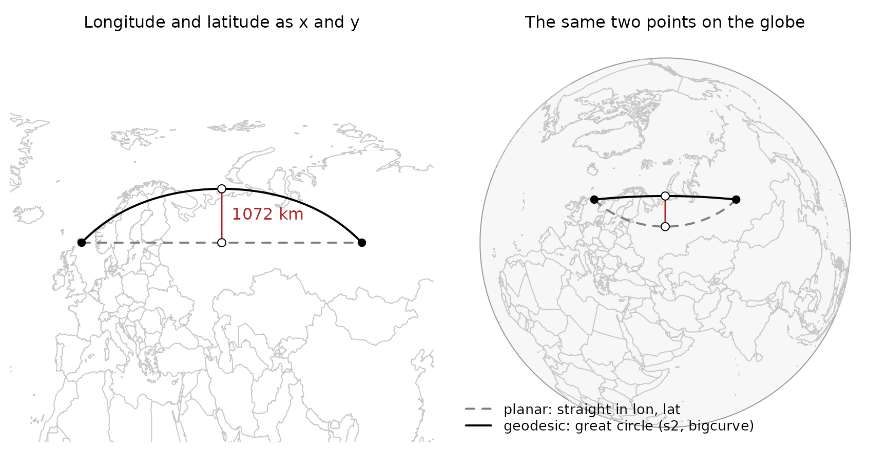
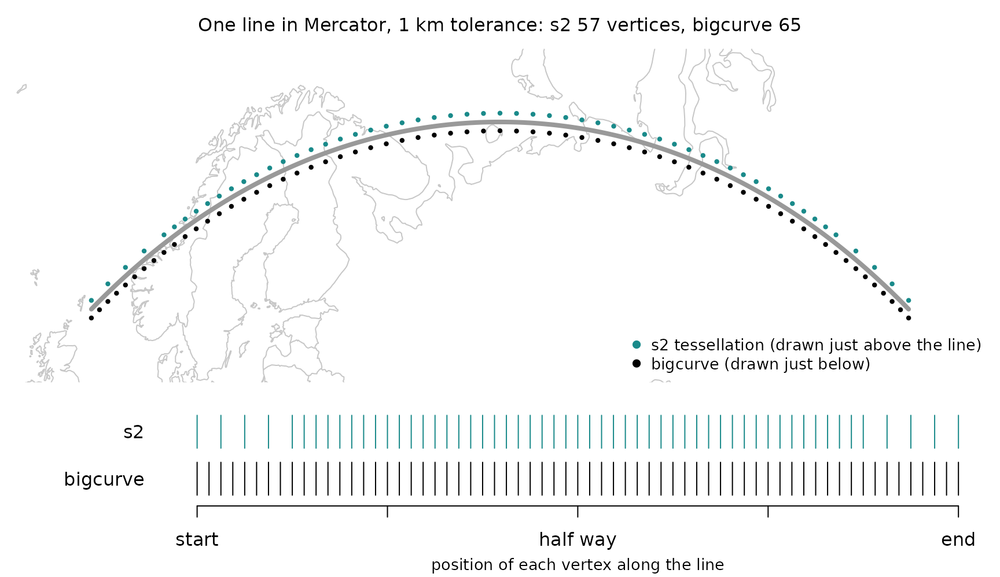
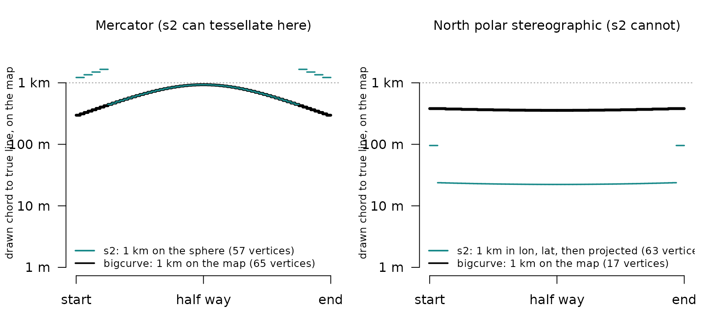
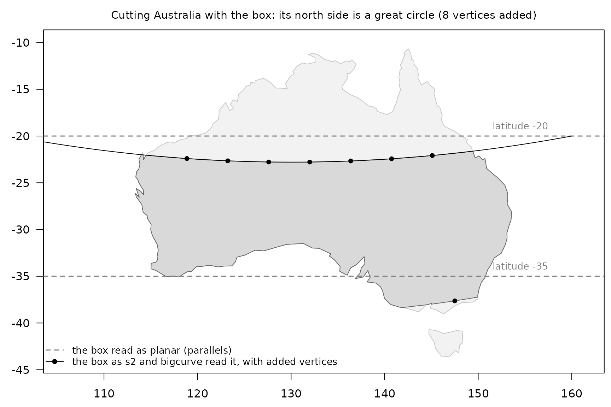

# bigcurve and s2: drawing the sphere on a flat map

If you already use s2 (directly, or through sf, where it is the default
for longitude and latitude data) you may wonder where bigcurve fits. The
short answer: **they agree on what a line between two points on the
Earth is, and they answer different questions about it.**

- s2 answers *“what is this shape on the sphere, and how does it relate
  to other shapes?”* Does it intersect, what is its area, what is the
  union, how far apart are these?
- bigcurve answers *“how many points do I need to draw this shape in a
  given map projection so that it looks right, and no more?”*

In every figure below s2 is teal, bigcurve is black, and the planar
reading of the same coordinates is a grey dashed line. One line runs
through the whole guide: along latitude 60, from longitude 0 to 100.

## At a glance

|  | s2 | bigcurve |
|----|----|----|
| Job | geometry on the sphere: predicates, areas, unions, distances | drawing: just enough vertices for one map |
| Edges | great circles | great circles |
| Works in | 3D unit vectors, no projection | the plane of the target map |
| Tolerance measured | on the sphere (metres converted to an angle) | on the map, in the map’s units |
| Projections for tessellating | plate carree, Mercator, orthographic | anything PROJ can do |
| Output | s2 geography, or projected coordinates | longitude, latitude, so any tool can project it |
| Input | s2 geography | matrices, segment meshes, wkpool topology (so any wk-readable data) |
| Planar edges to geodesic | yes, on import (`planar = TRUE`) | no |

``` r

library(bigcurve)
library(s2)
the_line <- rbind(c(0, 60), c(100, 60))
line <- s2_make_line(the_line[, 1], the_line[, 2])
```

## What is a line between two points?

Give a computer two points in longitude and latitude and ask for the
line between them. There are two common answers.

1.  The **planar** answer: draw a straight line in longitude, latitude
    space, as if the coordinates were x and y on graph paper. This was
    what sf and GEOS did for years, and what most file formats quietly
    assume.
2.  The **geodesic** answer: follow the shortest path over the surface
    of the Earth, a great circle arc.

s2 takes the second answer for every edge, and so does bigcurve. The
planar middle of our line is (50, 60). The great circle middle is a long
way north of it:

``` r

s2_as_text(s2_interpolate_normalized(line, 0.5))
#> [1] "POINT (49.99999999999999 69.63942512488693)"

## how far is the planar middle from the true line, in metres?
s2_distance(s2_lnglat(50, 60), line)
#> [1] 1071857
```



More than a thousand kilometres. Neither answer is wrong: they are two
different shapes that happen to share their vertices. What matters is
knowing which one your data means. s2 makes the geodesic reading the
default; bigcurve assumes it.

## Does bigcurve draw s2’s line?

Yes. bigcurve inserts its new vertices exactly on s2’s arc. Densify the
line and ask s2 how far each new vertex is from it:

``` r

d <- densify(the_line, "+proj=laea +lon_0=50 +lat_0=60", tolerance = 1000)
nrow(d)
#> [1] 13
max(s2_distance(s2_lnglat(d[, 1], d[, 2]), line))
#> [1] 1.749256e-09
```

A few nanometres, which is floating point noise. The added vertices
change nothing about the shape on the sphere; they only make it explicit
for a flat drawing.

## Where is the work done?

s2 does all its work on the sphere itself. Internally every point is a
unit vector in three dimensions, and there is no map projection anywhere
in sight. That is why s2 has no trouble at the poles or at the
antimeridian: on a sphere there is no edge of the map to fall off.

bigcurve does its work in the **plane of the map you are going to
draw**. For each edge it projects the great circle midpoint with PROJ
and asks how far it lands from the straight chord between the projected
endpoints. If it is further than `tolerance` (in the map’s own units,
usually metres) the edge is split and both halves are checked again.
This is the adaptive resampling that Mike Bostock wrote for d3-geo.

So the same edge gets **different** numbers of vertices in different
projections, because the curve is a different shape on each map:

``` r

c(laea  = nrow(densify(the_line, "+proj=laea +lon_0=50 +lat_0=60", tolerance = 1000)),
  stere = nrow(densify(the_line, "+proj=stere +lat_0=90", tolerance = 1000)),
  merc  = nrow(densify(the_line, "+proj=merc", tolerance = 1000)))
#>  laea stere  merc 
#>    13    17    65
```

## Where do the vertices go?

s2 is not blind to this problem. Its C++ library has an *edge
tessellator* that turns geodesic edges into chains of straight edges in
a projection, and the R package exposes it when it writes data out, for
plate carree (longitude, latitude), Mercator and orthographic maps. Here
is our line tessellated for Mercator by both packages, each asked for 1
km:

``` r

merc <- "+proj=merc +R=6378137"
tol <- 1000

## s2, in its own Mercator, then back to longitude and latitude
m <- wk::wk_handle(line, wk::wkb_writer(),
                   s2_projection = s2_projection_mercator(),
                   s2_tessellate_tol = tol / s2_earth_radius_meters())
v_s2 <- rproj_xy(as.matrix(wk::wk_coords(wk::wkb(m))[, c("x", "y")]),
                 "OGC:CRS84", source = merc)

## bigcurve, for the same Mercator
v_bc <- densify(the_line, merc, tolerance = tol)

c(s2 = nrow(v_s2), bigcurve = nrow(v_bc))
#>       s2 bigcurve 
#>       57       65
```



In Mercator the two come out close, in count and in placement: both are
solving the same problem in the same spirit. The difference is in what
“1 km” means.

## What does a tolerance mean?

s2 measures its tolerance **on the sphere**; bigcurve measures it **on
the map**. On a map that stretches distances, as Mercator does by a
factor of two at latitude 60, those are not the same thing. And s2 can
only aim at its three projections: for any other map the best it can do
is tessellate in longitude and latitude and hope that is fine enough.

The figure measures, for every drawn chord, how far it strays on the map
from the true projected line.



On the left, s2’s 1 km on the sphere becomes up to 1.7 km on the
Mercator map near the ends of the line, while bigcurve stays under 1 km
everywhere. On the right, s2’s longitude, latitude tessellation happens
to be far finer than this map needs: 63 vertices for errors of tens of
metres, where 17 keep bigcurve under 1 km. On another map, or another
line, the same tessellation could just as easily be too coarse.
bigcurve’s tolerance is always “how far may the drawn line stray on
*this* map”.

The “planar edges to geodesic” row of the table deserves a sentence too.
If your data really are planar in longitude and latitude (a coastline
digitised on a plate carree map, say), s2 can densify on the way *in*
(`s2_geog_from_wkb(..., planar = TRUE)`) so that its geodesic edges
follow the planar ones. bigcurve never does this. It always assumes the
edges you hand it are great circles.

## Using them together

Because both packages agree on what an edge is, a natural pipeline is s2
for the analysis and bigcurve for the drawing. Here is a “box” written
with four corners, from longitude 100 to 160 and latitude -35 to -20. We
cut Australia with it in s2, then densify what the cut produced for a
map in plain longitude and latitude:

``` r

box <- s2_make_polygon(c(100, 160, 160, 100), c(-35, -35, -20, -20))
aus <- s2_data_countries("Australia")
cut <- s2_intersection(aus, box)

pool <- wkpool::establish_topology(wk::as_wkb(cut))
out <- densify(pool, "+proj=eqc")
c(before = nrow(wkpool::pool_vertices(pool)),
  after  = nrow(wkpool::pool_vertices(out)))
#> before  after 
#>    110    118
```



Read as s2 reads it, the box’s north side is not latitude -20: it is a
great circle that dips to -22.8 in the middle, and that is the line s2
cut along. The coastline is already finely detailed and is left alone;
the new vertices go only along the long sides the box contributed.
Drawing the grey reading while analysing the black one is how a map ends
up disagreeing with its own analysis.

To draw the result in any other projection, turn the pool back into
geometry and project it. The fast general path is wk and PROJ: build the
transform once with
[`PROJ::proj_trans_create()`](https://hypertidy.github.io/PROJ/reference/proj_trans_create.html)
and stream the geometry through
[`wk::wk_transform()`](https://paleolimbot.github.io/wk/reference/wk_transform.html).
Any other tool that projects (sf, terra) works too, since the densified
vertices are ordinary longitude, latitude points. Remember to densify
for the map you are drawing:

``` r

prj <- "+proj=laea +lon_0=130 +lat_0=-30"
geom <- wkpool::cycles_to_wkb(wkpool::merge_coincident(densify(pool, prj)))
drawn <- wk::wk_transform(geom, PROJ::proj_trans_create(wk::wk_crs(geom), prj))
dc <- wk::wk_coords(drawn)
op <- par(mar = rep(0.5, 4))
plot(range(dc$x), range(dc$y), type = "n", asp = 1,
     axes = FALSE, xlab = "", ylab = "")
plot(drawn, col = "grey85", add = TRUE)
```


``` r

par(op)
```

## What else is the same, and what is not?

- **Both are spherical.** s2 uses a sphere of radius about 6371 km; so
  does bigcurve’s midpoint. Neither follows the ellipsoid. For drawing a
  map this makes no visible difference; for survey-grade distances use
  geographiclib (through sf or geosphere).
- **Neither clips.** If part of a line is beyond the horizon of an
  orthographic map, s2 can intersect with
  [`s2_hemisphere()`](https://r-spatial.github.io/s2/reference/wk_handle.s2_geography.html)
  first; bigcurve leaves unprojectable edges alone and never errors.
- **The antimeridian.** s2 has no seam at all. bigcurve keeps whatever
  longitudes you gave it: an edge along 180 stays at 180, an edge
  written from 170 to -170 is refined through 180 continuously. If you
  need the two copies of the seam to be one boundary, densify first and
  then fuse with `wkpool::merge_coincident(period_x = 360)`.
- **Operations.** Union, intersection, buffer, distance, area and
  containment are s2’s job. bigcurve has one verb,
  [`densify()`](https://hypertidy.github.io/bigcurve/reference/densify.md),
  and it does not change the shape.

## In one sentence

Use s2 to decide *what* the shape is; use bigcurve to draw *that* shape,
honestly, in whatever projection your map needs.
